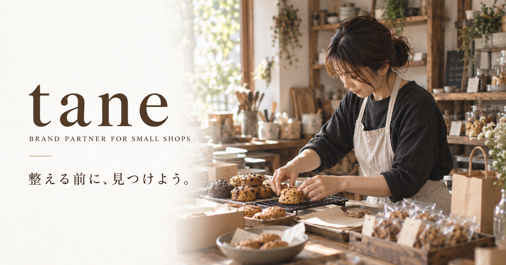

# tane｜小さなお店のためのブランド伴走サービス

小規模店舗がすでに持っている魅力を見つけ、言葉とデザインの判断軸へ整理する架空のブランド伴走サービス。その価値を伝える1ページLPを、課題設定から公開まで一貫して制作しました。

- [Live Demo](https://coconattsu0723.github.io/tane-brand-partner-lp/)
- [GitHub Repository](https://github.com/Coconattsu0723/tane-brand-partner-lp)

| Item | Detail |
| --- | --- |
| Project | tane / 小さなお店のためのブランド伴走サービス LP |
| Type | 自主制作 / 架空サービス / 1ページLP |
| Target | 開業1〜5年程度の小規模な個人店 |
| Core Problem | 店らしさを、言葉とデザインの判断基準として持てていない |
| Scope | Planning / Brand / Copy / Design / Development / Publish |
| Tech | HTML5 / CSS3 / Vanilla JavaScript |
| Published | GitHub Pages |

> この作品は架空案件です。CV、売上、問い合わせ数などの事業成果は計測していません。本Case Studyでは、実際に行った設計・実装と確認できた技術的な結果のみを扱います。

---

## 01. Project Overview

### 制作概要

taneは、WebやSNSを個別に整える前に、その店らしさを言葉とビジュアルの判断基準へ整理するブランド伴走サービスです。開業後に少しずつ増えたWeb、SNS、写真、紙ものを、外から新しい世界観を与えて揃えるのではなく、店の日常にある価値からつなぎ直す設定にしました。

LPはサービスの認知だけでなく、「見た目の不統一だと思っていた悩みの背景に、判断軸の未整理がある」と気づき、相談を検討できる状態まで心理を進める役割を持ちます。

### 制作目的

目的は架空サイトを見栄えよく仕上げることではなく、小規模店舗のブランド課題を設定し、Core Problem、提供価値、ブランド、情報設計、ビジュアル、実装、公開を一つの論理でつなぐことでした。

参考サイトからは、見た目や固有表現ではなく、WHYからHOW、WHATへ進む情報の組み立てと、CTAを繰り返して押すのではなく不安を減らして行動へつなぐ考え方を抽出しました。

### 担当範囲

- 参考サイト分析、企画、ターゲット・課題・提供価値設計
- ブランドコンセプト、ネーミング、コピー、情報設計
- UI / Visual Design、ビジュアル方向設計、画像制作・選定
- HTML / CSS / Vanilla JavaScript、Responsive、Accessibility
- 画像最適化、Metadata、OGP、favicon
- Git / GitHubによる工程管理、GitHub Pages公開

---

## 02. Background / User Problem

### Surface Problem

想定した店主には、日々の制作物に次のような違和感があります。

- Instagramへ載せる写真の選び方に迷う
- Webサイトが現在の店の雰囲気と合っていない
- 名刺、ショップカード、メニュー、写真の方向が少しずつ異なる
- 店の魅力をうまく説明できない
- 制作者へ依頼するとき、「ナチュラルな感じ」など曖昧な指示になる

これらを単なる「統一感不足」として扱うと、色やフォントを揃える対処で終わります。しかし、新しい制作物が必要になるたびに同じ迷いが戻るなら、解くべきなのは表現の結果ではなく、判断の根拠です。

### Core Problem

**自分の店らしさを、言葉とデザインの判断基準として持てていない。**

このCore Problemを起点にすると、Web、SNS、紙ものを同じ見た目にすることが目的ではなくなります。接点ごとに適切な表現が違っても、「自分の店らしいか」を同じ軸で判断できる状態が解決になります。

そのためLPでも、Problemの直後に「揃っていないのは、デザインではなく、軸かもしれません。」というProblem Insightを置き、表面的な悩みから本質課題へ一段深く進めました。

### Emotional Problem

**大切に育ててきた店の魅力が、外からはちゃんと伝わっていない気がする。**

対象者は自分の店を否定しているのではなく、愛着があるからこそ伝わり方に不安を持っています。そこで、不安を煽る警告色や「悪い状態から劇的に改善する」演出は避けました。店の中にすでに価値があると認める語り口と、押しつけのない余白をLP全体の態度にしています。

---

## 03. Target

主な対象は、開業1〜5年程度のカフェ、焼き菓子店、ベーカリー、花屋、雑貨店、セレクトショップなど、小規模な個人店です。

開業前ではなく、一定期間営業している店を設定した理由は、すでに次のような「店らしさの材料」が蓄積されているからです。

- 店を始めた理由と店主の価値観
- 選び続けてきた商品や素材
- 接客の仕方
- 店内の空間、道具、光
- 常連客との関係
- お客様に過ごしてほしい時間

一方で、必要な制作物をその都度用意してきたため、それらの材料がブランドとして整理されていない。この「魅力はあるが、判断軸になっていない」段階と、taneの提供価値が自然につながるようにしました。

---

## 04. Value Proposition

提供価値をFunction、Benefit、Essential Valueの3階層に分けました。

| Level | Value |
| --- | --- |
| Function | 店の価値、言葉、ビジュアルの判断基準を整理する |
| Benefit | Web、SNS、店頭ツールを作るたびに方向性を考え直さず、一貫して判断できる |
| Essential Value | 自分の店の魅力を、自信を持って伝え続けられる |

Functionはサービス内容を理解するために必要ですが、Heroで最初に伝えると説明的になり、対象者自身の悩みとつながりにくくなります。そのためHeroでは「整える前に、見つけよう。」とEssential Valueに近い入り口をつくり、具体的な方法は後続のDiscover / Define / Expressで説明しました。

これにより、「ブランド資料を作るサービス」ではなく、自分たちで判断し、伝え続けられる状態をつくるサービスとして位置づけています。

---

## 05. Brand Concept

### Brand Concept

**店らしさは、つくるのではなく見つける。**

### Brand Message

**店らしさは、もうそこにある。**

### Hero Main Copy

**整える前に、見つけよう。**

ブランド名の「tane」は、完成したブランドを外から持ち込むのではなく、店の中にある小さな手がかりを見つけ、育てられる形にする考え方から選びました。

このConceptを判断基準にしたことで、コピー、写真、Service構成、Case Studyの流れが同じ方向を向きました。写真では完成された店舗だけでなく手元や道具を扱い、Serviceでは制作物の納品よりも発見と整理を先に置き、Case StudyではBeforeを否定的に見せない設計につながっています。

---

## 06. Information Architecture

LPの順序は、掲載項目の一覧ではなく、相談までに必要な心理変化から設計しました。

**共感 → 問題認識 → 解決理解 → 信頼 → 比較・判断 → 不安解消 → 行動**

配置理由が重要な箇所を、次のように整理しました。

| Section | この位置に置いた理由 |
| --- | --- |
| Problem / Insight | 日常の迷いへ共感した直後に原因を深め、サービス都合の問題提起に見せない |
| Brand Philosophy → Service | 問題の直後に「材料はすでにある」という希望を返してから、解決方法を示す |
| Before / After → Case Study | 判断の変化を短く示した後、発見から展開までの工程を具体例で証明する |
| Process → Plan | 進め方の不安を減らしてから、期間・料金・範囲を比較できるようにする |
| About → FAQ | 誰と進めるかを伝えた後、相談直前の具体的な疑問を解消する |
| Final CTA / Contact | 理解と判断材料が揃った段階で、未整理の状態でも相談できると伝える |

CTAはページ内のContactへ統一しました。強く繰り返すのではなく、Hero、Plan、Final CTAなど意味のある節目に絞っています。

---

## 07. Design Direction

正式なデザイン方向は **Editorial & Natural**。Editorial 80%、Warm & Friendly 20%を目安に、写真主体の静かな読み物として構成しました。

Quiet / Warm / Honest / Thoughtful / Editorial / HumanというKeywordsを、整って見えることと、小規模店舗の日常から離れすぎないことの両立へ置き換えました。

### Hierarchyをつくる要素

- Photography：説明だけでは伝わらない店の空気と手仕事を見せる
- Typography：Serifの見出しとSans Serifの本文・UIで役割を分ける
- Whitespace：情報を区切り、売り込みすぎない態度をつくる
- Thin Border：カードや色面に頼らず、項目と工程を整理する
- Layout：写真比率、非対称な幅、縦横の切り替えで重要度を示す

配色はWarm Off White `#F8F6F1`をベースに、Deep Brown `#332F2A`、Sub Text `#6F6961`、Muted Olive `#66705C`を必要な範囲で使用しています。広い色面よりも、写真に含まれる木、紙、自然光が温度を担う設計です。

### 避けた表現

- 全セクションのカード化と均一な情報ブロック
- 大きな角丸、強いShadow、Glassmorphism
- 過度なGradientや背景色の切り替え
- Badge、Icon、Pill Buttonの多用
- 強いParallaxや意味のないScroll Animation

AIテンプレート感を減らすため、同じ形のパーツを反復するだけの構成にはせず、内容の関係性に応じてリスト、比較、写真と文章、縦の工程を使い分けました。装飾量ではなく、各セクションに一つの意味を持たせることを優先しています。

---

## 08. Visual / Photography Direction

初期の画像方向は、空間が整いすぎている、暗い、演出されたブランド写真に見えるといった課題がありました。画面単体の完成度よりも、「店の日常にすでに魅力がある」というConceptとの一致を優先する必要がありました。

そこで、写真方向を **Candid / Authentic / Lived-in / Documentary-like** へ修正。店主の手元、作業途中のノート、道具、包装、商品、少し生活感の残る空間を選びました。

軸にした要素は、自然光、木、紙、焼き菓子、手仕事、日本の小規模店舗として自然な距離感です。強いHDR、ドラマチックな照明、広告モデルのような人物、不自然に多い小物を避け、使用感を残しています。

写真の完成度が高すぎると、対象者が自分の店とは違うと感じたり、サービスが外から理想像を与えるように見えたりします。写真の自然さを、ブランドへの信頼をつくるUIの一部として扱いました。

正式なページ内ビジュアルは写真17点とロゴ1点の計18点です。HeroのみSP / PC別画像を用意し、その他は共通画像を基本とすることで、画面幅ごとの世界観のずれと管理の複雑化を抑えました。

---

## 09. Hero Design

Heroでは、コピーを説明ブロック、写真を装飾ブロックとして分離せず、一つの情景として見せることを目指しました。

### SP / 375px基準

Mobile Heroは、Header直下から縦長写真をHero全体の基盤として配置し、その上にWarm Off WhiteのFade、Service Category、Main Copy、Sub Copy、CTAを重ねています。

上側はコピーのコントラストを確保し、下側ほど店主、手元、商品が見えるFadeにしました。`100svh`を考慮した可変の最小高さを使い、小さい端末で内容が切れず、長すぎる固定Heroにもならないようにしています。PC用Supporting Visualは表示せず、Main Photo 1枚へ情報を集中させました。

### PC / 1024px以上

PCでは横長画像を右へ大きく配置し、左側から中央に向かって透明になるWarm WhiteのFade上へコピーを載せています。単純なText / Photoの2カラムではなく、写真と文章が中央で自然につながる統合ビジュアルです。

写真はviewport右端まで届け、下部には店内、商品、包装を補うSupporting Visual 3枚を中央配置しました。Main Photoだけでは伝えにくい店舗全体の接点を補いながら、主役より目立たないサイズと彩度に調整しています。

---

## 10. Responsive Design

Mobile Firstで375pxの意味順を先に成立させ、`768px`と`1024px`を主なBreakpointに設定しました。確認幅は375 / 390 / 768 / 1024 / 1366 / 1440pxです。

幅が増えたから横並びにするのではなく、同時に見ることで理解しやすくなる情報だけを多列化しました。

| Section | PCでの判断 | 理由 |
| --- | --- | --- |
| Service | 写真と文章を工程ごとに交互配置 | Discover → Define → Expressの縦順を保ちつつ、単調な反復を避ける |
| Case Study | 工程を交互2カラム、Afterを非対称Gridにする | 順序を保ちながら、Webを主役に各接点の役割と画像比率を活かす |
| Process | Intro左 / Vertical Process右 | 5工程は比較ではなく時間順なので、横Timelineにしない |
| FAQ | 中央の1列を維持 | 質問を左右へ分散させず、開閉と読み進める順序を明確にする |

CSS Gridで視覚配置を変える場合も、HTML上の工程順や見出し順は維持しました。Responsiveを見た目の変換ではなく、情報関係の再配置として設計しています。

---

## 11. Case Study Section Design

ブランド伴走は成果が見えにくいため、LP内に開業3年目の架空焼き菓子店を用いたCase Studyを設けました。

**Before → Discovery → Brand Axis → After**

Beforeは「悪いデザイン」や「古い店」にはしていません。一つひとつのWeb、SNS、写真、紙ものは成立しているものの、作るたびに参照する判断軸がないため、方向が少しずつ異なる状態です。この設定により、「ダサいものをおしゃれにする」話ではなく、すでにある魅力を整理するサービスだと伝えています。

Discoveryでは、店主、商品、手仕事、包装、道具、店内から、その店らしさの材料を拾います。それを次のBrand Axisへ整理しました。

> 忙しい日常の中で、少し立ち止まれる時間を届ける。

Keywordsは「静か / 素朴 / あたたかい / 日常 / 余白 / 手仕事」。Badgeや多色Boxにはせず、言葉そのものをThin Borderで整理し、判断基準として見せています。

Afterでは同じ軸をWeb、Social、Package / Cardへ展開しました。すべてを同じ見た目にするのではなく、Webでは空気感、Socialでは日々の発信、Packageでは手渡す瞬間という役割に合わせながら、同じ判断軸から表現できることを可視化しています。

---

## 12. Interaction / JavaScript

JavaScriptは技術要素を増やすためではなく、静的なHTMLだけでは不足する操作と状態管理に限定しました。

- **Mobile Navigation**：`button`で開閉し、表示状態を`aria-expanded`と同期。Escapeで閉じた場合はトグルへフォーカスを戻し、画面幅の切り替え時に状態をリセットします。
- **FAQ Accordion**：質問を`button`、回答を`aria-controls`で関連づけました。回答同士を比較できるよう、複数Openを許可しています。
- **Demo Form**：必須項目とURL形式を検証し、項目別エラー、`aria-invalid`、最初のエラーへのフォーカス移動、`aria-live`のSuccess Stateを実装しました。

このフォームはポートフォリオ用Demoであり、`submit`時に外部サービスやメールへデータを送信しません。画面内にもその旨を明記しています。

ContactへのAnchor CTAとSticky Headerも、長いLP内で移動先を見失わないための機能として採用しています。

---

## 13. Accessibility

Accessibilityは最後に項目を追加するのではなく、HTML構造、操作要素、状態管理の選択に含めました。

`lang="ja"`、Semantic HTML、1つの`h1`から始まる見出し階層、内容に応じた`ol` / `ul` / `dl`を採用。写真は文脈上必要な場合だけ説明的なaltを付け、本文と重複する補助写真は`alt=""`としました。Skip Linkも設けています。

| UI | 実装上の配慮 |
| --- | --- |
| Mobile Menu | Keyboard操作、Escape Close、Focus Restore、状態と`aria-expanded`の同期 |
| FAQ | `button`と`aria-controls`で質問・回答を関連づけ、開閉状態を通知 |
| Form | `label`、文章によるエラー、最初のInvalid FieldへのFocus、`aria-live`による完了通知 |
| Motion / Visual | `:focus-visible`、約44pxの操作領域、主要色のContrast、`prefers-reduced-motion`対応 |

写真上のHero CopyにはFadeを介し、背景の明暗が変わっても読みやすさを保つようにしました。

---

## 14. Performance

正式PNG 18点はMaster Assetとして原寸のまま保持し、レイアウト完成後に実表示サイズを監査してProduction用WebP 18点を生成しました。

| Asset | Total Size |
| --- | ---: |
| PNG Master | 36,852,110 B / 35.14 MiB |
| Production WebP | 1,971,458 B / 1.88 MiB |
| Reduction | 34,880,652 B / **94.7%** |

原寸PNGをそのまま配信すると、画面上の表示サイズに対して過剰なデータ転送になります。一方、先に一律縮小すると、PC HeroやRetina表示で必要な解像度を失う可能性があります。そのため、Responsive完成後に各画像の最大CSS表示寸法を確認し、Retina 2xを基準に個別のProduction寸法を決めました。

- Hero SP / PCは元解像度を維持し、quality 88で画質を優先
- HeroはLazy Loadせず、`fetchpriority="high"`を指定
- Supporting VisualはHeroの一部として通常読み込み
- FV外の画像は`loading="lazy"`と`decoding="async"`
- Production実寸に合わせた`width` / `height`でCLSを抑制
- ロゴは透明エッジを保つLossless WebPを使用

圧縮率だけでなく、使用位置、表示寸法、読み込み優先度を一つのPerformance設計として扱いました。

---

## 15. Metadata / Publishing

公開前に、ページ内容を表すtitleとdescription、1200 × 630pxのOGP画像、Twitter Card、32px / 48px PNGとICOのfaviconを整備しました。

公開URLが未確定の段階ではURLを推測せず、GitHub Pages公開後に`canonical`、`og:url`、`og:image`、`twitter:image`を正式なProduction URLへ更新しました。公開先は [Live Demo](https://coconattsu0723.github.io/tane-brand-partner-lp/) です。

---

## 16. Improvements During Production

制作中は、完成前の見た目を固定せず、Conceptと実表示に照らして修正しました。

| Improvement | Before | After / Reason |
| --- | --- | --- |
| Image Direction | 整いすぎた、演出感の強い写真 | Documentary-likeな光、手元、道具、生活感へ修正し、店にすでにある魅力を伝えた |
| Hero Layout | SPではCopyとPhotoが分離、PCではGallery下に過剰な余白 | SPは写真・Fade・Copyを統合。PCは不要な`min-height` / Paddingを解除し、Problemまで128pxに整理した |
| Responsive | Mobileの縦積みをそのまま拡大 | 比較、工程、写真の役割ごとに交互配置、非対称2カラム、Editorial Gridへ再設計した |
| Performance | 原寸PNGをそのまま配信する状態 | 表示寸法とRetinaを監査し、用途別のProduction WebPへ切り替えた |
| Production Metadata | 公開URLが未確定 | Pages公開後にcanonical、OGP / Twitter画像の絶対URLを正式化した |

Heroの余白修正では負のmarginで隠さず、どの要素が高さを持っているかを確認して原因側を変更しました。

---

## 17. Result

架空案件のため、売上やCVといった事業成果はResultに含めていません。制作・実装上、確認できた到達点は次のとおりです。

- 課題設定、提供価値、ブランド、情報設計、デザイン、実装、公開を一貫して制作
- 375〜1440pxの6幅でResponsive表示を確認
- 各確認幅で横スクロールがない状態を維持
- Mobile Menu、FAQ、Form Validation、CTA、Sticky Headerの主要Interactionを確認
- Semantic HTML、Keyboard操作、Focus、ARIA、Form Error、Reduced Motionへ対応
- PNG Masterを保持しながらProduction WebP 18点へ切り替え、画像容量を削減
- title、description、canonical、OGP、Twitter Card、faviconを整備
- Git / GitHubで工程を管理し、GitHub Pagesへ公開

設計資料、画像台帳、意思決定ログもMarkdownで残し、最終実装までの判断を追える状態にしています。

---

## 18. What I Learned

### 1. Webデザインより前に判断軸をつくる

Core Problem、Essential Value、Brand Conceptを先に定義すると、写真やレイアウトを雰囲気だけで選ばずに済みます。次回も、Visualへ進む前に判断基準を言語化します。

### 2. Responsiveは横並び化ではない

Before / Afterは同時比較、Processは時間順が重要です。次回も画面幅ではなく、情報同士の関係から多列化を判断します。

### 3. 写真の自然さもUI設計の一部になる

高精細で整った画像が、必ずしもブランドへの信頼につながるとは限りません。次回も構図だけでなく、人物との距離、作業の痕跡、光、使用感を選定基準に含めます。

### 4. Performanceは圧縮操作だけではない

実表示サイズ、Retina、読み込み優先度、CLSまで合わせて考えると、画質と転送量を両立できます。次回もResponsive確定後に表示用途を監査してから最適化します。

### 5. 公開まで含めてWeb制作を考える

ブラウザで表示できるだけでは、共有時の見え方や検索結果へ渡す情報は完成しません。次回もMetadata、OGP、favicon、Production URL、公開確認までを制作工程に含めます。
