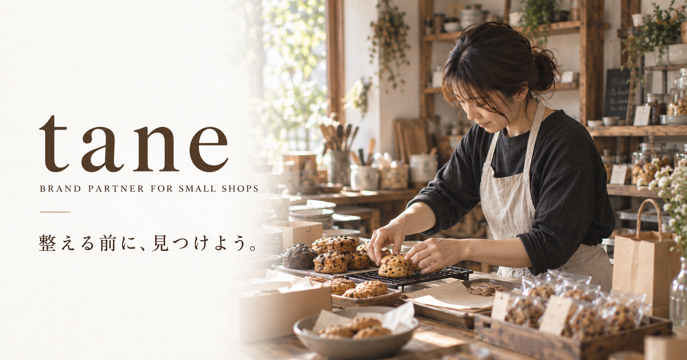

# tane

「店らしさ」を言葉とデザインの判断軸へ整える、小さなお店向けブランド伴走サービスの架空LPです。

自主制作として、課題設定・ブランド設計・コピー・情報設計から、ビジュアル制作、HTML / CSS / Vanilla JavaScriptによる実装、最適化、GitHub Pagesでの公開まで一貫して行いました。



## Demo

- [Live Demo](https://coconattsu0723.github.io/tane-brand-partner-lp/)
- [GitHub Repository](https://github.com/Coconattsu0723/tane-brand-partner-lp)

## Overview

| 項目 | 内容 |
| --- | --- |
| Project | tane |
| Category | 小さなお店のためのブランド伴走サービス LP |
| Type | 自主制作 / 架空サービス / 1ページLP |
| Target | 開業1〜5年程度のカフェ、焼き菓子店、ベーカリー、花屋、雑貨店、セレクトショップなどの小規模な個人店 |
| Goal | 店の魅力を言語化し、Web・SNS・写真・紙ものを一貫して判断できる軸の価値を伝える |

### 制作範囲

企画、ターゲット・課題・価値設計、ブランドコンセプト、コピー、情報設計、UI / Visual Design、画像制作・選定、HTML / CSS / Vanilla JavaScript、レスポンシブ、アクセシビリティ、画像最適化、Metadata / OGP / favicon、Git / GitHub、GitHub Pages公開。

### Tech Stack

- HTML5
- CSS3
- Vanilla JavaScript
- Git / GitHub
- GitHub Pages

## Concept

| 項目 | 内容 |
| --- | --- |
| Core Problem | 自分の店らしさを、言葉とデザインの判断基準として持てていない。 |
| Essential Value | 自分の店の魅力を、自信を持って伝え続けられる。 |
| Brand Concept | 店らしさは、つくるのではなく見つける。 |
| Brand Message | 店らしさは、もうそこにある。 |
| Hero Main Copy | 整える前に、見つけよう。 |

完成物を先に考えるのではなく、店を始めた理由、商品選び、接客、空間といった日常の中から「店らしさ」を見つけ、継続して使える判断軸にすることをサービスの中心に据えました。

## Design

デザインコンセプトは **Editorial & Natural**。写真主体の静かなEditorial LPとして設計しています。

- Keywords：Quiet / Warm / Honest / Thoughtful / Editorial / Human
- 写真、タイポグラフィ、余白、細い罫線を主な構成要素に採用
- Warm Off Whiteと深いブラウンを基調に、落ち着いた配色を設計
- 見出しはSerif、本文・UIはSans Serifで役割を分離
- 過剰なカード、強い影、大きな角丸、装飾的なアイコンを抑制
- 写真を飾りではなく、店らしさの根拠や変化を伝える情報として配置

## Information Architecture

ユーザーの心理変化を、次の順序で設計しました。

**共感 → 問題認識 → 解決理解 → 信頼 → 比較・判断 → 不安解消 → 行動**

Heroから日常の違和感を言語化し、Problem Insightで課題の本質を提示。PhilosophyとServiceで解決の考え方を伝えた後、Before / After、Deliverables、Case Studyで具体化します。さらに対象者、工程、プラン、運営者、FAQを通して判断材料と安心を補い、Contactへつなげています。

## Key Features

### Brand-first Planning

Webデザインから始めず、ターゲットの状況、課題、本質的な価値、ブランドの判断軸を先に定義しました。コピーとビジュアルは、その軸から一貫して展開しています。

### Editorial Layout

情報を同じ形のカードへ分割しすぎず、写真の比率、文字組み、非対称な2カラム、余白の強弱で読ませる構成にしました。

### Process-oriented Case Study

成果物だけでなく、Before → Discovery → Brand Axis → Afterの順で、店らしさを見つけて複数の接点へ展開する過程を示しています。

### Mobile First

375pxを基準に情報の優先順位と縦方向のリズムを設計し、画面が広がる段階で必要な箇所だけを多列化しました。

### Accessible Interaction

メニュー、FAQ、フォームをキーボードでも操作できるようにし、状態変化やエラーが支援技術にも伝わる構造を採用しています。

## Functionality

- Mobile Navigation：開閉、リンク選択時の閉鎖、Escape、フォーカス復帰
- FAQ Accordion：複数項目を同時に開閉可能
- Form Validation：必須項目とURL形式を検証し、最初のエラーへフォーカス
- Demo Success State：送信完了の状態を画面内で通知
- Anchor CTA：各CTAからContactへ移動
- Sticky Header：スクロール中も主要ナビゲーションへアクセス可能

フォームはポートフォリオ用のデモ実装であり、入力内容を外部へ送信しません。

## Responsive

Mobile Firstで実装し、`768px`と`1024px`を主なブレークポイントに設定しました。検証幅は `375 / 390 / 768 / 1024 / 1366 / 1440px` です。

- 375〜390px：写真・フェード・コピーを一体化したMobile Heroと縦方向の読みやすさを優先
- 768px以上：対象者とプランなど、比較が有効な箇所を2列化
- 1024px以上：PC Header / Hero、非対称2カラム、Serviceの交互配置、Case StudyのEditorial Gridへ展開
- Processは意味上の順序を守るため、PCでも縦方向を維持
- 標準コンテナは最大`72rem`、Service / Case Studyは最大`80rem`

PC版はMobile版の単純な拡大ではなく、写真の見せ場と文章の流れに合わせてレイアウトを再構成しています。

## Accessibility

- `header`、`nav`、`main`、`section`、`footer`と見出し階層によるSemantic HTML
- 意味のある順序には`ol` / `ul`、プラン情報には`article` / `dl`を使用
- キーボード操作と`:focus-visible`のフォーカス表示
- メニューとFAQの`aria-expanded` / `aria-controls`同期
- フォームの`label`、`aria-invalid`、エラー時のフォーカス移動
- 完了状態を伝える`aria-live`
- 約44px以上の主要タップ領域と文字色のコントラストを確保
- `prefers-reduced-motion`に応じてアニメーションを抑制

## Performance

PNG原本をマスターとして保持し、表示用に同一内容のWebP 18点を作成しました。

| 対象 | 合計容量 |
| --- | ---: |
| PNG Master | 35.14 MiB |
| Production WebP | 1.88 MiB |
| Reduction | **94.7%** |

- Hero画像は品質を優先し、`fetchpriority="high"`を指定
- HeroとSupporting Visualには遅延読み込みを適用しない
- FV外の画像には`loading="lazy"`と`decoding="async"`を指定
- Production画像の実寸に合わせた`width` / `height`でレイアウトシフトを抑制

## Metadata / SEO

- ページ内容を明示する`title`と`description`
- 正式公開URLを設定した`canonical`と`og:url`
- 1200 × 630pxのOGP画像とOpen Graph metadata
- Twitter Card metadata
- 32px / 48px PNGおよびICOのfavicon
- OGP / Twitter画像には公開先の絶対URLを設定

## Project Structure

```text
tane-brand-partner-lp/
├── index.html
├── css/
│   └── style.css
├── js/
│   └── main.js
├── assets/
│   └── images/
│       ├── hero/
│       ├── philosophy/
│       ├── service/
│       ├── deliverables/
│       ├── case-study/
│       ├── about/
│       ├── logo/
│       ├── ogp/
│       └── favicon/
├── 00_PROJECT_BRIEF.md
├── 01_CONTENT_STRUCTURE.md
├── 02_DESIGN_RULES.md
├── 03_IMAGE_ASSETS.md
├── 04_IMPLEMENTATION_RULES.md
├── 05_DECISIONS_LOG.md
├── 06_IMAGE_AND_DESIGN_DIRECTION.md
├── 07_LAYOUT_AND_WIREFRAME.md
└── README.md
```

8つのMarkdownを企画・情報設計・デザイン・画像・実装・意思決定の正本として管理し、実装時の判断根拠を残しています。

## Development Process

```text
Reference Analysis
→ Business / Target
→ Problem
→ Value
→ Brand
→ Content / Information Architecture
→ UI / Visual Design
→ Image Production
→ Mobile Implementation
→ Responsive Design
→ Performance
→ Metadata
→ GitHub Pages Publish
```

各工程をGit commitとして分け、設計、Mobile実装、Responsive、画像最適化、Metadata、公開設定の変化を追えるようにしました。

## Links

- [Live Demo](https://coconattsu0723.github.io/tane-brand-partner-lp/)
- [Repository](https://github.com/Coconattsu0723/tane-brand-partner-lp)
